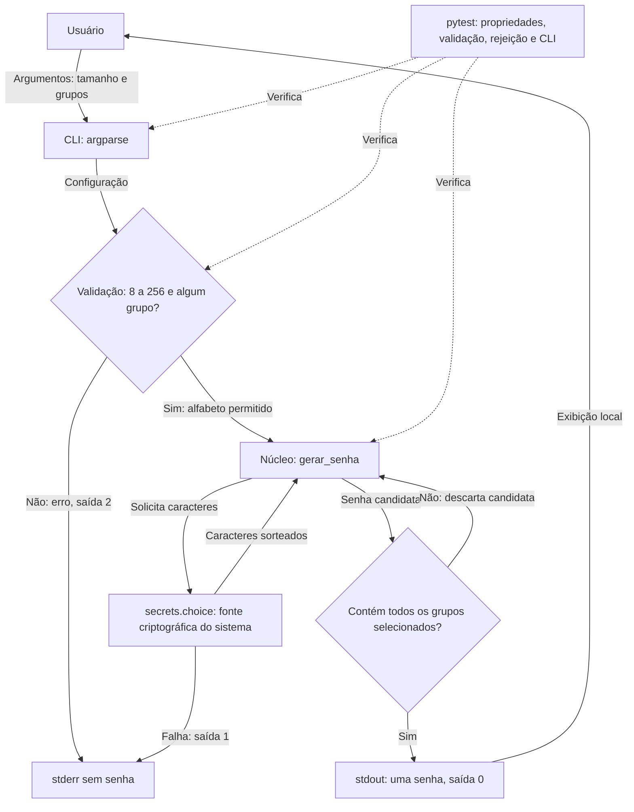

# Gerador de Senhas Seguras

Aplicação Python de linha de comando que gera senhas localmente com aleatoriedade criptográfica. Permite configurar o tamanho e selecionar letras maiúsculas, minúsculas, números e símbolos, sem enviar senhas pela rede.

[Repositório](https://github.com/andreborten/gerador-senhas) · [Escopo e requisitos](docs/escopo-mvp.md) · [Revisão do MVP](docs/revisao-escopo.md) · [Mermaid](docs/arquitetura.mmd) · [Licença MIT](LICENSE)

## Funcionalidades

- Uma senha por execução; padrão de 20 caracteres com os quatro grupos.
- Comprimento entre 8 e 256 caracteres, inclusive.
- Exclusão independente de símbolos, números, maiúsculas e minúsculas.
- Pelo menos um caractere de cada grupo habilitado; nenhum dos grupos excluídos.
- Validação de configuração, ajuda integrada e função reutilizável em Python.

## Instalação e ambiente

Requer Git e Python 3.10+. A versão de referência é 3.15.0, registrada em `.python-version`; a validação local foi feita em Windows com essa versão. Não é necessário instalar ORM, banco de dados, Node.js ou configurar chave de API.

```shell
git clone https://github.com/andreborten/gerador-senhas.git
cd gerador-senhas
python -m venv .venv
```

Ative o ambiente conforme seu terminal:

```powershell
# Windows PowerShell
.\.venv\Scripts\Activate.ps1
```

```bat
:: Windows Prompt de Comando
.venv\Scripts\activate.bat
```

```sh
# Linux/macOS (use python3 para criar o ambiente se necessário)
source .venv/bin/activate
```

Instale as dependências de teste:

```shell
python -m pip install -r requirements.txt
```

A execução usa apenas a biblioteca padrão; `pytest==9.1.1` é a única dependência direta externa, usada para testes. O pip também instala suas dependências transitivas. O arquivo não é um lock completo dessas dependências.

Se o PowerShell bloquear a ativação, use diretamente `.\.venv\Scripts\python.exe` no lugar de `python`; não é necessário alterar a política de execução.

## Uso pela CLI

```shell
python gerador.py
python gerador.py --tamanho 24
python gerador.py -t 32 --sem-simbolos
python gerador.py -t 20 --sem-numeros --sem-maiusculas
python gerador.py -t 24 --sem-simbolos --sem-numeros --sem-maiusculas
python -m gerador_senhas --tamanho 24
python gerador.py --help
```

Cada geração bem-sucedida imprime apenas uma senha em uma linha. O último exemplo de geração com três exclusões usa somente minúsculas. Os caracteres permitidos são `a-z`, `A-Z`, `0-9` e `!@#$%&*+-=?_`. Todos os grupos começam habilitados; as opções `--sem-*` removem grupos.

| Opção | Comportamento |
| --- | --- |
| `-t`, `--tamanho` | Inteiro entre 8 e 256; padrão 20 |
| `--sem-simbolos` | Exclui símbolos |
| `--sem-numeros` | Exclui números |
| `--sem-maiusculas` | Exclui letras maiúsculas |
| `--sem-minusculas` | Exclui letras minúsculas |
| `-h`, `--help` | Mostra ajuda |

### Erros

```shell
python gerador.py --tamanho 7
python gerador.py --sem-simbolos --sem-numeros --sem-maiusculas --sem-minusculas
```

Ambos os comandos são inválidos. A CLI informa o motivo em stderr, não imprime senha e encerra com código 2. Sucesso e ajuda retornam 0. Falha de acesso à fonte criptográfica retorna 1, sem gerar uma senha alternativa.

### Uso em código Python

```python
from gerador_senhas import gerar_senha

senha = gerar_senha(24, usar_simbolos=False, usar_numeros=True,
                    usar_maiusculas=True, usar_minusculas=True)
```

A importação antiga `from gerador import gerar_senha` continua funcionando. A API exige tamanho inteiro (não aceita booleanos) e opções booleanas. Tipos incorretos geram `TypeError`; tamanho fora da faixa ou ausência de grupos gera `ValueError`; falhas da fonte segura propagam `OSError`.

## Tecnologias e IA generativa

| Tecnologia | Uso |
| --- | --- |
| Python 3.10+ | Linguagem; referência local 3.15.0 |
| `argparse` | Processamento de argumentos e ajuda |
| `secrets` e `string` | Sorteios criptográficos e alfabetos |
| pytest 9.1.1 | Testes unitários e integração da CLI |
| Git / GitHub | Versionamento e distribuição |
| Mermaid | Diagrama de fluxo e comunicação dos componentes |
| OpenAI Codex | Assistência na lógica, testes, interface e documentação |

IA é usada durante o desenvolvimento, não na execução. Não há modelo de IA embarcado, chamada de API ou dependência de Copilot. A versão exata do modelo de assistência não é fixada pelo projeto. Python/argparse é a alternativa escolhida do escopo; Click, JavaScript, ORM e Pydantic não são necessários ao MVP.

## Segurança

O núcleo usa `secrets.choice`, apoiado pela fonte criptográfica do sistema operacional. Cada candidata é sorteada uniformemente do alfabeto habilitado. Candidatas que não contêm todos os grupos escolhidos são rejeitadas: isso preserva a distribuição uniforme entre senhas válidas, sem inserir caracteres obrigatórios em posições previsíveis.

O padrão usa 20 caracteres. Aceitar 8 caracteres atende compatibilidade, mas não torna qualquer configuração forte: comprimento e alfabeto importam. Use senhas únicas por conta, um gerenciador de senhas e MFA quando disponível.

A aplicação não grava senhas em arquivos ou logs e não usa rede. A saída é texto claro no terminal; gravações de sessão, capturas de tela e redirecionamento podem expô-la. Não há apagamento garantido de memória. `.gitignore` cobre padrões comuns de credenciais e caches, mas não detecta segredos inseridos em código.

## Testes automatizados

```shell
python -m pytest -q
```

A suíte contém 96 casos: todas as 15 combinações não vazias de grupos nos tamanhos 8, 20 e 256; presença e exclusão de caracteres; valores e tipos inválidos; rejeição de candidata incompleta; falha da fonte criptográfica; ajuda, entradas por script/módulo e códigos de saída. A CLI também é executada em subprocessos reais.

A rejeição e a falha da fonte são testadas com substituições controladas. Não usamos ausência de duplicatas em uma amostra como prova de segurança. Os testes não demonstram imprevisibilidade criptográfica nem garantem ausência de colisões. Resultado local da revisão: **96 testes passaram em Windows/Python 3.15.0**.

## Arquitetura e comunicação

`core.py` concentra validação e geração; `cli.py` recebe argumentos e controla saída/erros. `gerador.py` preserva a entrada anterior e o pacote suporta execução por módulo.



O arquivo fonte está em [docs/arquitetura.mmd](docs/arquitetura.mmd). O diagrama representa apenas componentes implementados.

## Organização

```text
gerador-senhas/
├── gerador.py
├── gerador_senhas/
│   ├── __init__.py
│   ├── __main__.py
│   ├── core.py
│   └── cli.py
├── tests/test_gerador.py
├── docs/
│   ├── arquitetura.mmd
│   ├── escopo-mvp.md
│   └── revisao-escopo.md
├── requirements.txt
├── .gitignore
├── .python-version
├── LICENSE
└── README.md
```

## Limitações e Próximos Passos

- CLI local: não há web, API HTTP, persistência ou sincronização.
- Não há medidor de força, verificação de vazamentos ou frases-senha.
- Não há saída mascarada, integração com gerenciadores ou limpeza garantida de memória.
- Não há geração em lote ou alfabetos personalizados.
- Python 3.10+ é o mínimo de sintaxe; a revisão não executou uma matriz de versões/sistemas.
- Próximas evoluções: CI multiplataforma, empacotamento, frases-senha e opções adicionais de alfabeto.

Veja os limites e critérios de aceite completos no [escopo do MVP](docs/escopo-mvp.md).

## Versionamento e entrega

A tag `v1.0.0` preserva a entrega anterior. A revisão com seleção dos quatro grupos, pytest e escopo formal corresponde à versão `v1.1.0`. Tags identificam pontos de entrega; não pressupõem a criação de uma página GitHub Release.

```shell
git fetch --tags
git switch --detach v1.1.0
```

Para contribuir, crie uma branch, execute os testes e use Conventional Commits, por exemplo `feat: adiciona frases-senha` ou `docs: esclarece instalação`.

## Créditos e licença

Autor: [andreborten](https://github.com/andreborten). Desenvolvimento assistido por OpenAI Codex. Projeto distribuído sob a [licença MIT](LICENSE).
