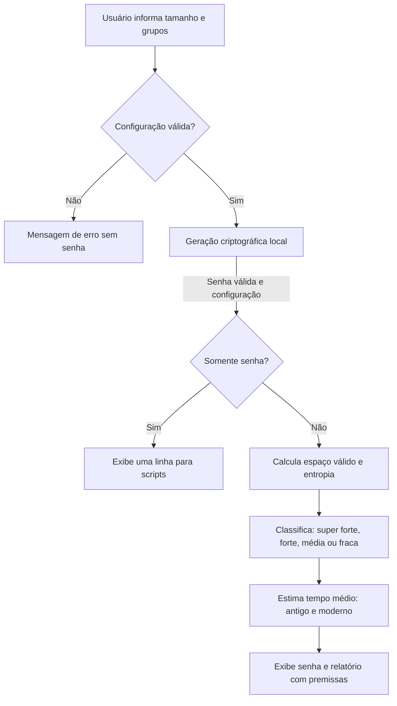

# MVP — Gerador de Senhas Seguras

## Visão do produto

Este documento apresenta o produto mínimo viável implementado, baseado nos [requisitos funcionais e não funcionais](escopo-mvp.md). A base funcional é a versão `v1.3.0`. O MVP é uma aplicação Python com GUI Tkinter e CLI executável localmente, não apenas uma proposta de desenvolvimento.

**Problema:** criar senhas conforme as regras de um serviço e compreender sua resistência estimada a tentativas de adivinhação.

**Objetivo:** permitir gerar uma senha aleatória, selecionar comprimento e tipos de caracteres e visualizar uma avaliação de força acompanhada de estimativas de força bruta.

**Público:** usuários de interface gráfica ou terminal e desenvolvedores que desejam integrar a função em scripts Python.

**Valor entregue:** geração com fonte criptográfica do sistema, execução local sem envio de senhas e avaliação transparente, com premissas documentadas.

## Funcionalidades mínimas entregues

| Necessidade do usuário | Entrega do MVP | Requisitos |
| --- | --- | --- |
| Gerar uma senha rapidamente | Uma senha de 20 caracteres por padrão | RF01 |
| Adequar a senha ao serviço | Tamanho de 8 a 256; seleção independente de minúsculas, maiúsculas, números e símbolos | RF02–RF07 |
| Entender entradas inválidas | Ajuda, mensagens de erro e códigos de saída | RF08–RF09, RF11 |
| Reutilizar em scripts | Função `gerar_senha`, execução por módulo e `--somente-senha` | RF10, RF15 |
| Entender a força estimada | Classes super forte, forte, média e fraca, com entropia em bits | RF12 |
| Comparar capacidades de ataque | Tempo médio de força bruta offline nos cenários antigo e moderno, com ressalvas | RF13–RF14 |

Todos os grupos começam habilitados. Cada senha deve conter ao menos um caractere de cada grupo selecionado e nenhum caractere fora desses grupos. Não é permitido desabilitar todos os grupos.

## Jornada principal

1. O usuário abre o terminal na pasta do projeto.
2. Executa a CLI com as opções desejadas ou aceita o padrão.
3. A aplicação valida a configuração e gera uma senha usando `secrets`.
4. A aplicação calcula o espaço de senhas válidas e a entropia da configuração.
5. A senha é exibida na primeira linha, seguida da força e dos dois tempos estimados.
6. O usuário pode gerar outra senha com critérios diferentes; o programa não mantém histórico.



O [diagrama técnico dos componentes](arquitetura.mmd) detalha a comunicação entre CLI, núcleo, fonte aleatória e avaliação.

## Como executar o MVP

Pré-requisito: Python 3.10 ou superior. A validação registrada foi realizada no Windows com Python 3.15.0. Para obter o código:

```shell
git clone https://github.com/andreborten/gerador-senhas.git
cd gerador-senhas
python -m venv .venv
```

No Windows, é possível executar diretamente o Python do ambiente, sem ativá-lo:

```powershell
.\.venv\Scripts\python.exe -m pip install -r requirements.txt
.\.venv\Scripts\python.exe gerador.py --tamanho 20
.\.venv\Scripts\python.exe -m pytest -q
```

No Linux/macOS, substitua esse caminho por `.venv/bin/python`. Se necessário, use `python3` ao criar o ambiente. Consulte também a [instalação completa no README](../README.md).

A execução não exige pacotes externos. `requirements.txt` contém `pytest==9.1.1` para os testes. Não é necessário banco de dados, servidor, conta de serviço ou chave de API.

No Windows, também é possível abrir `iniciar.bat` por duplo clique. Sem argumentos, o iniciador abre a GUI. Com argumentos, executa a CLI e mantém o resultado visível.

## Roteiro de demonstração e aceite

Com o ambiente ativado, execute:

| Passo | Comando | Resultado esperado |
| --- | --- | --- |
| Padrão | `python gerador.py` | Senha de 20 caracteres com os quatro grupos, classe super forte e dois tempos estimados |
| Personalização | `python gerador.py -t 24 --sem-simbolos` | Senha de 24 caracteres sem símbolos, contendo letras dos dois tipos e números |
| Avaliação fraca | `python gerador.py -t 8 --sem-simbolos --sem-maiusculas --sem-minusculas` | Oito dígitos, classe fraca, aproximadamente 26,58 bits |
| Avaliação média | `python gerador.py -t 16 --sem-simbolos --sem-maiusculas --sem-minusculas` | Dezesseis dígitos, classe média |
| Avaliação forte | `python gerador.py -t 20 --sem-simbolos --sem-maiusculas --sem-minusculas` | Vinte dígitos, classe forte |
| Avaliação super forte | `python gerador.py -t 25 --sem-simbolos --sem-maiusculas --sem-minusculas` | Vinte e cinco dígitos, classe super forte |
| Integração | `python gerador.py --somente-senha` | Somente uma linha contendo a senha |
| Erro de tamanho | `python gerador.py -t 7` | Mensagem em stderr, nenhuma senha e código 2 |
| Ajuda | `python gerador.py --help` | Lista de opções e código 0 |
| Testes | `python -m pytest -q` | Suíte concluída sem falhas |

As senhas variam a cada execução; os critérios da saída são o objeto do aceite, não um valor fixo de senha. O exemplo numérico curto demonstra uma configuração fraca e não constitui recomendação de uso.

## Critérios da avaliação

| Entropia | Classe |
| --- | --- |
| Menos de 40 bits | fraca |
| De 40 até menos de 60 bits | média |
| De 60 até menos de 80 bits | forte |
| 80 bits ou mais | super forte |

A avaliação considera comprimento, tamanho do alfabeto e a obrigação de incluir todos os grupos escolhidos. Para N senhas válidas, a entropia é `log2(N)` e o tempo médio é `(N + 1) / (2 × taxa)`.

São usados dois cenários hipotéticos offline: antigo, com 1 milhão de tentativas/s, e moderno, com 100 bilhões de tentativas/s. Não são medições de hardware. Os limiares de classificação são convenções do projeto; tempos dependem do hash, custo e capacidade do atacante. Não são garantias ou prazos mínimos. Consulte a [metodologia completa](forca-senha.md).

## Qualidade e evidências

- `core.py`: validação compartilhada e geração com `secrets.choice`, usando rejeição de candidatas incompletas.
- `cli.py`: argumentos, ajuda, saída e tratamento de erros.
- `forca.py`: contagem de combinações válidas, classificação e tempos com suporte a 256 caracteres sem overflow.
- `tests/test_gerador.py` e `tests/test_forca.py`: 154 casos aprovados na validação da versão v1.3.0, incluindo as 15 combinações válidas de grupos, erros, fronteiras das classes e verificação matemática independente.
- Tipagem, docstrings, licença MIT, dependências declaradas e `.gitignore` integram a entrega.

A correspondência detalhada com RNF01–RNF13 está no [escopo](escopo-mvp.md); o histórico de verificação está no [relatório de revisão](revisao-escopo.md). Testes não provam imprevisibilidade criptográfica nem ausência absoluta de colisões.

## Limites do MVP

A CLI exibe texto claro; a GUI permite revelar a senha mascarada. Há máscara visual na GUI, mas não há armazenamento, sincronização ou limpeza garantida da memória. Configurações fracas continuam permitidas e são identificadas pela avaliação. O programa não verifica vazamentos nem avalia senhas humanas existentes.

Não fazem parte desta entrega: interface web, API HTTP, banco de dados, geração em lote, alfabetos personalizados, medição real de hardware ou matriz automatizada de sistemas operacionais. Nenhuma dessas funções é necessária para executar a alternativa CLI selecionada.

## Próximos incrementos

1. Automatizar os testes em CI para múltiplas versões de Python e sistemas.
2. Empacotar a aplicação para instalação e execução mais simples.
3. Avaliar frases-senha, caracteres ambíguos e alfabetos personalizados.
4. Considerar interface web ou integração com gerenciador de senhas mediante novos requisitos de segurança.

## Entrega e créditos

Código no [GitHub](https://github.com/andreborten/gerador-senhas), com base funcional marcada pela [tag v1.3.0](https://github.com/andreborten/gerador-senhas/tree/v1.3.0). Este documento consolida a apresentação do MVP após essa tag; a documentação atual está na branch `main`.

Autor: andreborten. Desenvolvimento assistido por OpenAI Codex na lógica, CLI, testes e documentação. A aplicação não usa IA durante a execução. Licença: [MIT](../LICENSE).

## Interface gráfica desktop

A interface usa **Tkinter e ttk**, bibliotecas do Python para janelas e widgets. Execute `python interface.py` ou `python -m gerador_senhas.gui`. No Windows, abra `iniciar.bat` por duplo clique. Com argumentos, esse iniciador continua executando a CLI; `python gerador.py` também permanece disponível.

A janela contém campo de comprimento (8–256), quatro caixas de seleção, botão **Gerar senha**, campo de senha oculto por padrão, opção **Mostrar senha**, classificação em texto e cor, entropia e tempos dos cenários antigo e moderno. Enter também gera. Senhas longas podem ser percorridas horizontalmente no campo. Ao alterar os critérios, o resultado anterior é limpo; cada nova geração volta a ocultar a senha. Erros aparecem na janela sem fechar a aplicação.

A máscara é apenas visual: não protege contra comprometimento da máquina nem garante limpeza da memória. A aplicação não copia automaticamente para a área de transferência, não salva e não envia senhas. As mesmas regras e premissas da CLI valem na interface gráfica.

### Instalação do Tkinter

`requirements.txt` documenta Tkinter/ttk, mas não declara um pacote pip chamado tkinter: ele é fornecido com Python e Tcl/Tk. No instalador oficial do Python para Windows, habilite o componente Tcl/Tk. Verifique com `python -m tkinter`, que deve abrir uma janela de diagnóstico. Em distribuições Linux, instale o pacote Tk da distribuição quando necessário (em Debian/Ubuntu, normalmente `python3-tk`). A interface exige sessão gráfica disponível; a CLI não exige Tkinter.

Referência: [documentação oficial do Tkinter](https://docs.python.org/3/library/tkinter.html). A instalação local foi validada com Python 3.15.0 e Tk 9.0. A execução não ganhou dependências pip; pytest continua sendo a dependência de testes.

### Testes da interface

`python -m pytest -q` inclui testes com widgets Tk reais: geração, máscara e revelação, erros, alterações de configuração, falha da fonte aleatória e tamanho máximo. Sem Tk ou sessão gráfica, esses testes são explicitamente ignorados; os testes de CLI e núcleo continuam disponíveis. Na validação local, **154 testes passaram, sem testes ignorados**.
